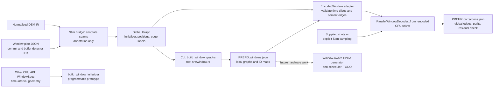
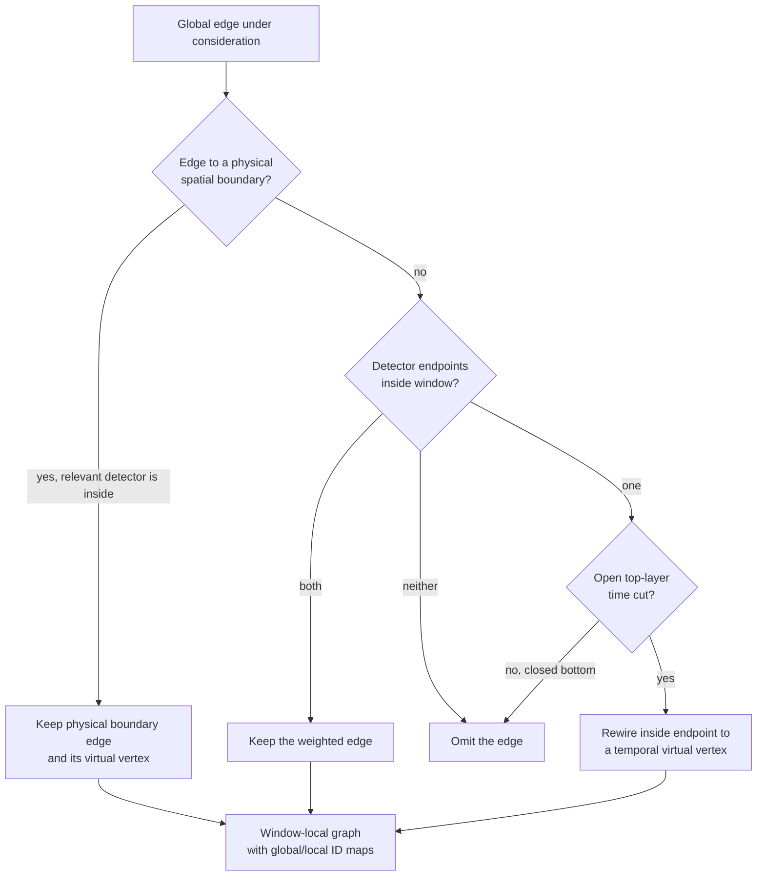
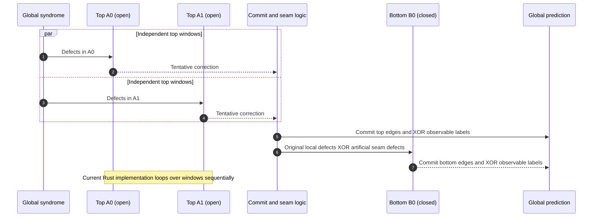

# Parallel-window graph encoding and CPU decoding

Here, **encoding** means turning a global *decoding graph* into window-local graphs and index maps; it does not mean encoding a logical qubit. The two-layer CPU decoder now consumes those exported local graphs through an explicit adapter (its older `WindowSpec` API can still build separate time-based graphs). The [Stim-to-Rust chapter](stim-to-rust-architecture.md) explains how the global graph is obtained.

> **Implementation boundary:** The IR still records an *annotation* and keeps the global graph unchanged. The CLI now cuts annotated graphs into `PREFIX.windows.json` and, when given `--shots` or `--sample-shots`, passes those same local graphs to `ParallelWindowDecoder` and writes verified `PREFIX.corrections.json`. CPU windows run **sequentially**; concurrent FPGA contexts and a window-aware Scala scheduler remain TODOs.

## 1. From the global graph to local windows

A plan such as [`examples/windows.json`](../../examples/windows.json) identifies `commit` and `buffer` **detector IDs** for each window. Python annotates which error components touch a commit/buffer seam or cross the outer window boundary; Rust checks the annotations again when importing IR. The plan does not itself select a correction or change graph connectivity.



There are **two related ways** to construct software windows:

- [`src/window.rs`](../../src/window.rs) uses validated `Graph.window_annotations` and `commit ∪ buffer` **detector IDs** to build `WindowGraph` values. Each carries an `initializer`, `positions`, `edge_metadata`, `detector_map` (local → global detector, or `None` for virtual vertices) and `edge_map` (local → global edge). The CLI now exports these as `PREFIX.windows.json` and passes the same graphs, with full observable-label lists, to the CPU [`ParallelWindowDecoder::from_encoded`](../../src/cpu/blossom/src/parallel_window.rs).
- [`src/cpu/blossom-nostd/src/window.rs`](../../src/cpu/blossom-nostd/src/window.rs) still defines programmatic `WindowSpec` **time intervals** and Riverlane, Sandwich and Contiguous generators. [`build_window_initializer`](../../src/cpu/blossom/src/parallel_window.rs) constructs local graphs from these specs for the original CPU API. The CLI does **not** silently translate an arbitrary detector-ID plan into a `WindowSpec`.

The CLI's [adapter](../../src/decoding.rs) instead requires complete, contiguous time slices and commits every edge touching a top commit detector. It rejects missing time coordinates, overlapping commits across layers, uncovered detectors and mismatched local/global edge maps before decoding. The original `WindowSpec` CPU constructor uses one optional observable per edge; the new encoded-window constructor supports the toolchain graph's **multiple** observable labels per edge.

### What happens to an edge at a time cut?



A temporal virtual vertex represents an **artificial window cut**, not a physical code boundary. Rewired edges retain the original weight and a global-edge mapping so committed edges can be accounted for globally. The root toolchain builder currently uses **one** temporal virtual per open annotated window; the CPU time-interval builder uses **past and future** temporal virtuals. Both omit crossing edges at closed time cuts and retain relevant physical boundary edges. These are software representations, not a completed FPGA implementation.

## 2. Two-layer correction flow

| | Layer 0 — top windows | Layer 1 — bottom windows |
|---|---|---|
| Time cuts | Open; defects may match a temporal virtual vertex. | Closed; no temporal virtual escape. |
| Region | Commit with buffers on either side where the time range permits. | Whole window committed; no buffer. |
| Input | Global defects in the window. | Original defects in the window **XOR** artificial defects from neighbouring top commits. |
| Output | Commit only tentative edges touching a commit detector; discard tentative buffer edges. | Commit the selected local correction in full. |
| Observable update | XOR committed edge labels into one global prediction. | XOR into that **same** prediction. |

The following is a **dependency diagram**, not a claim that the current CPU loop runs concurrently:



The [oracle](../../src/cpu/blossom-nostd/src/window_oracle.rs) expresses the global accounting with symmetric difference (XOR):

```text
C_top = {tentative edges touching a top commit detector}
R     = S XOR boundary(C_top)
O     = XOR of observable labels on committed edges from BOTH layers
```

Here `S` is the input syndrome, `boundary(C_top)` contains detectors incident to an odd number of committed edges, and `R` contains uncorrected original defects **plus** artificial seam defects. The CPU implementation accumulates the committed edges' outside-commit endpoint parity as artificial events and XORs those events with original defects inside each bottom window. Spatial virtual endpoints do not become artificial detectors.

**Tiny seam example:** on `D0 --e0-- D1 --e1-- D2`, let `S = {D0, D2}`. If a top decoder tentatively returns `{e0, e1}` but only `e0` is in its commit region, `e1` is discarded and `boundary({e0}) = {D0, D1}`. Thus `R = {D1, D2}`: `D1` is an artificial seam event, while `D2` is an original uncorrected defect. A bottom window can connect them with `e1`. If `e1` carries an observable label, only that bottom **commit**, not the discarded top tentative edge, contributes it to the global parity.

## 3. What runs today

- **Implemented in software:** `compile --windows` or `export` with annotated IR writes cut graphs and maps. With `--shots` or `--sample-shots`, it instantiates `ParallelWindowDecoder::from_encoded`, solves the local graphs with `SolverEmbeddedComb`, commits selected global edges, checks the global residual and publishes one correction per shot. Optional measured observable flips allow logical-error reporting.
- **Still explicit:** A circuit or DEM describes a *distribution*, not a specific syndrome. Without supplied or explicitly sampled shots, compilation outputs local graphs but no correction file. Decoding requires a plan whose time-slice coverage and commit ownership pass runtime checks.
- **Not implemented in hardware:** window-aware Scala/FPGA generation, bounded reconfiguration and an actual concurrent two-layer scheduler. The Mermaid concurrency above is the proposed architecture; current Rust window loops run sequentially.

After setting up Python/Stim as in the [toolchain chapter](stim-to-rust-architecture.md#4-try-the-working-software-path), run these from the repository root:

```sh
cargo run --locked -- compile examples/seam.dem --kind dem \
  --windows examples/windows.json --shots examples/seam-shots.json \
  --output artifacts/seam --python .venv/bin/python
cargo run --locked -- compile examples/tiny.stim \
  --windows examples/tiny-windows.json --sample-shots 24 --seed 7 \
  --output artifacts/tiny-windowed --python .venv/bin/python
cargo test --locked --lib decoding
python3 parallel_window_prototype.py
```

The first command cuts the annotated DEM and decodes the supplied seam shots; the second samples a Stim circuit and decodes those real shots in one invocation. For the JSON output contract, formal geometry and limitations see [the schema](../../docs/FORMAT.md) and [Parallel Window Decoding](../../docs/PARALLEL_WINDOW.md).
