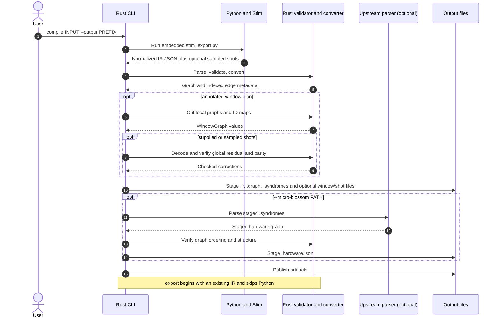

# Stim to Rust decoding-graph toolchain

This chapter follows a **Stim circuit or detector error model (DEM)** through Rust graph compilation and the optional software window decoder. Real supplied or sampled syndromes can now be decoded in the same CLI invocation; nothing here generates window-aware FPGA logic. See [parallel-window graph encoding and CPU decoding](parallel-window-architecture.md) for the two-layer algorithm.

## 1. Dataflow and ownership

```mermaid
flowchart LR
    CIRCUIT["Stim circuit (.stim)"] --> STIM["Stim: detector error model"]
    DEM["Existing DEM (.dem)"] --> STIM
    STIM --> PY["compile: embedded Python bridge<br/>tools/stim_export.py"]
    PLAN["Optional --windows plan"] --> PY
    PY --> IR["Normalized schema-v1 DEM IR<br/>mechanisms, coordinates, provenance<br/>window annotations"]
    IR --> VALIDATE["Rust: parse and validate IR"]
    OLD["Existing IR JSON<br/>export: no Python"] --> VALIDATE
    VALIDATE --> CONVERT["Rust: convert to even-weight<br/>graphlike decoding graph"]
    CONVERT --> GRAPH["Graph wrapper: initializer,<br/>positions, edge metadata"]
    VALIDATE --> IRFILE["PREFIX.ir.json"]
    GRAPH --> GRAPHFILE["PREFIX.graph.json"]
    GRAPH --> INPUT["PREFIX.syndromes<br/>upstream parser input"]
    GRAPH --> CUT["build_window_graphs<br/>when annotated"]
    CUT --> WINDOWFILE["PREFIX.windows.json"]
    WINDOWFILE --> DECODER["CPU ParallelWindowDecoder<br/>real syndrome shots"]
    SHOTS["--shots JSON or<br/>--sample-shots Stim"] --> DECODER
    DECODER --> CORRECT["PREFIX.corrections.json<br/>verified global edges and parity"]
    INPUT -. "optional --micro-blossom" .-> PARSER["Upstream micro_blossom parser"]
    GRAPH -. "structural comparison" .-> VERIFY["Rust: verify_hardware_graph"]
    PARSER --> VERIFY
    VERIFY --> HARDWARE["PREFIX.hardware.json"]
```



The bridge is [`tools/stim_export.py`](../../tools/stim_export.py), **embedded at build time** into the Rust CLI with `include_str!`; `compile` launches a Python interpreter with that script. It accepts a circuit or an existing DEM, uses Stim to flatten/normalize DEM error mechanisms, and writes a schema-v1 IR to stdout for Rust to consume. An optional `--windows` plan adds **metadata to the IR**; Rust then cuts window-local graphs separately. `export` starts from existing IR and skips Python/Stim entirely, including when decoding externally supplied shots.

The Rust side in [`src/main.rs`](../../src/main.rs), [`src/validation.rs`](../../src/validation.rs), and [`src/lib.rs`](../../src/lib.rs) revalidates the IR, merges independent error mechanisms with identical detector support, and assigns **even integer log-odds weights** for the upstream solver. A one-detector mechanism becomes an edge to a **physical virtual boundary**; two-detector mechanisms become ordinary edges. The `Graph` wrapper preserves an index-aligned `edge_metadata` entry per weighted edge, including observable IDs and source indices. The legacy upstream parser input does not carry those observable labels; use the wrapper to evaluate global correction parity.

## 2. File contract and optional parser

| Artifact | Producer | Meaning |
|---|---|---|
| `PREFIX.ir.json` | Python bridge on `compile`, or existing IR on `export` | Versioned normalized DEM, detector coordinates, provenance and optional `window_annotations`. |
| `PREFIX.graph.json` | Rust converter | `initializer` (`vertex_num`, `weighted_edges`, `virtual_vertices`), visualization positions, and index-aligned edge/observable metadata. |
| `PREFIX.syndromes` | Rust serializer | Upstream `ErrorPatternReader`/`parser` input: a header, initializer JSON (including edges and virtual vertices), and positions JSON (three lines); **not** shot-by-shot syndrome output. |
| `PREFIX.windows.json` | Rust `build_window_graphs` if IR has window annotations | Actual per-window initializer, positions, edge metadata and local/global detector/edge maps. |
| `PREFIX.corrections.json` | CPU `ParallelWindowDecoder` with `--shots` or `--sample-shots` | Per-shot global committed edges, logical predictions, checked empty residual, and optional actual-observable comparison. Not fabricated without a syndrome. |
| `PREFIX.hardware.json` | Optional upstream `parser` invoked by `--micro-blossom` | Parser-produced graph file, verified by Rust against the converted graph before publication. Not an FPGA window generator. |



If validation fails, the tool reports an error rather than silently rewriting unsupported DEMs. For example, hyperedges (more than two detectors), undetectable logical faults, and correlated decompositions without `--allow-correlated` are rejected. The optional upstream parser result is checked for graph/index agreement before being accepted. Consult [the format reference](../../docs/FORMAT.md) and [integration guide](../../docs/INTEGRATION.md) for exact fields, constraints and parser invocation.

## 3. The window annotation boundary

For a runnable plan use [`examples/windows.json`](../../examples/windows.json). The bridge expects a top-level `windows` list, with **only** `id`, `layer`, `commit`, and `buffer` in each entry. `commit` and `buffer` are detector-ID lists, not time intervals. Rust preserves validated annotations in the IR and global graph JSON, then **calls** [`build_window_graphs`](../../src/window.rs) to emit separate `.windows.json` for `compile` and annotated-IR `export`. If shots were requested it passes those graphs to the [CPU adapter](../../src/decoding.rs), rather than treating the annotation itself as a decoded graph.

[`examples/parallel_window_windows.json`](../../examples/parallel_window_windows.json) is a richer **illustrative** plan with additional description/temporal-boundary fields; it is not valid input to the strict Python `--windows` loader. The older CPU `WindowSpec` API describes half-open **time intervals** and a boundary mode; the CLI uses the new explicit-graph constructor of [`ParallelWindowDecoder`](../../src/cpu/blossom/src/parallel_window.rs) instead. Without `--shots` or `--sample-shots` no correction is computed, and none of these artifacts is a window-aware FPGA graph generator.

## 4. Try the working software path

Run from the repository root with Python/Stim installed:

```sh
python3 -m venv .venv
. .venv/bin/activate
python -m pip install -r requirements.txt
cargo run --locked -- compile examples/tiny.stim --output artifacts/tiny \
  --python .venv/bin/python
cargo run --locked -- compile examples/seam.dem --kind dem \
  --windows examples/windows.json --shots examples/seam-shots.json \
  --output artifacts/seam --python .venv/bin/python
cargo run --locked -- compile examples/tiny.stim \
  --windows examples/tiny-windows.json --sample-shots 24 --seed 7 \
  --output artifacts/tiny-windowed --python .venv/bin/python
cargo run --locked -- export artifacts/seam.ir.json \
  --shots examples/seam-shots.json --output artifacts/seam-copy
```

The first command compiles the circuit without a window plan; the next two compile and decode supplied or Stim-sampled shots. `export` decodes again from annotated IR and an explicit JSON shot batch **without Python**. Without shots the CLI cuts annotated windows but does not fabricate a syndrome. Add `--micro-blossom /path/to/micro_blossom` to a `compile` or `export` invocation only if you have built the compatible upstream executable and want the verified optional hardware graph. See [parallel-window architecture](parallel-window-architecture.md) for the seam algorithm and runtime plan constraints.
